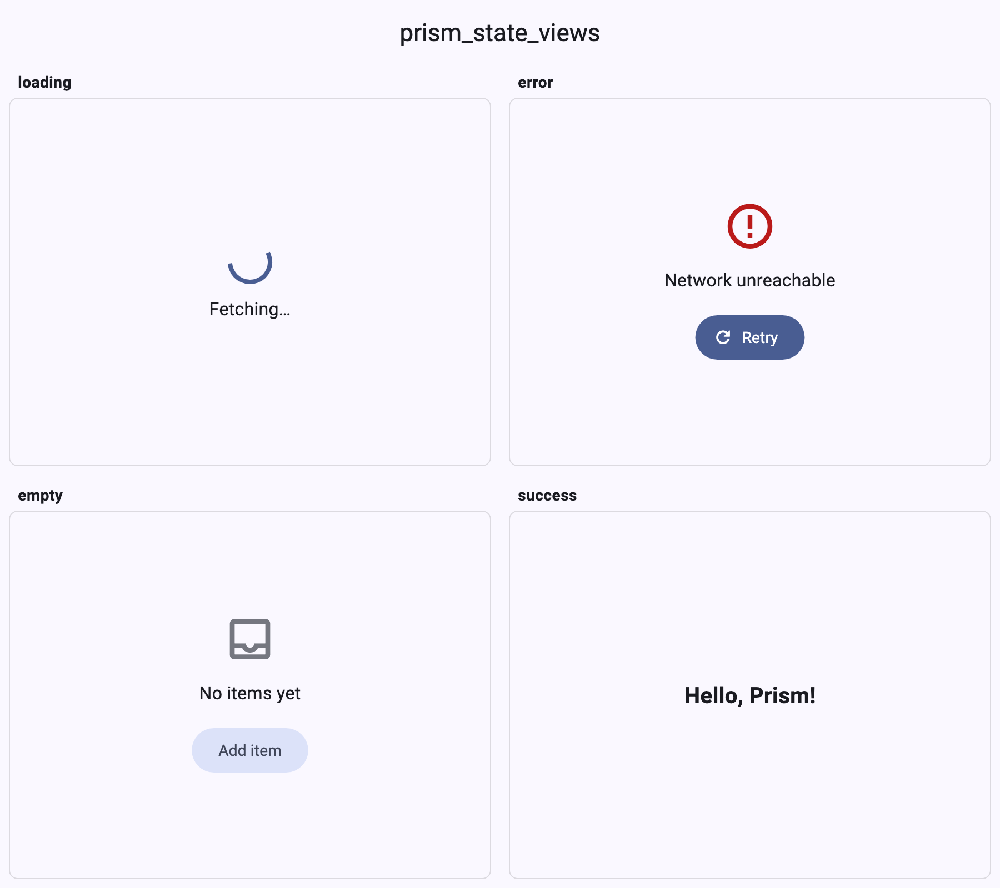

# prism_state_views

**One widget for empty, loading, error, and success states in Flutter** —
with retry callbacks, Dart 3 sealed view-state classes, and compiler-checked
exhaustiveness. Pure Flutter, all six platforms.

## Features

- ✅ `PrismStateView` renders all four async UI states from one widget
- ✅ Dart 3 `sealed class PrismViewState<T>` — the compiler forces you to
  handle every state, no forgotten error branches
- ✅ Built-in "Retry" button on errors (opt-in via `onRetry`)
- ✅ Empty-state action button
- ✅ `PrismViewStateNotifier.fromFuture` for apps without state management
- ✅ Animated cross-fade between states
- ✅ All six Flutter platforms: Android, iOS, macOS, Windows, Linux, Web

## Installation

```yaml
dependencies:
  prism_state_views: ^0.1.0
```

## Usage

```dart
PrismStateView<List<Item>>(
  state: state, // PrismViewState<List<Item>>
  onRetry: () => refetch(),
  emptyMessage: 'No items yet',
  emptyActionLabel: 'Add item',
  onEmptyAction: () => openEditor(),
  successBuilder: (items) => ListView.builder(
    itemCount: items.length,
    itemBuilder: (context, i) => ListTile(title: Text(items[i].name)),
  ),
)
```

### Exhaustive switching (the Dart 3 way)

```dart
final widget = switch (state) {
  PrismViewLoading(:final message) => Text(message ?? 'Loading…'),
  PrismViewError(:final error) => Text('Failed: $error'),
  PrismViewEmpty() => const Text('Nothing here'),
  PrismViewSuccess(:final data) => Text(data.first.name),
};
```

Add a new state to the sealed class and every switch in your codebase stops
compiling until it's handled — that's the whole point.

### Without a state-management package

```dart
final state = PrismViewStateNotifier.fromFuture(loadItems());
// Use with ValueListenableBuilder, or pass .value to PrismStateView.
```

## The Prism package family

These packages are designed to work together:

| Package | What it does |
| --- | --- |
| [prism_markdown](https://pub.dev/packages/prism_markdown) | Markdown widget with full CommonMark + GFM support |
| [prism_code_view](https://pub.dev/packages/prism_code_view) | Syntax-highlighted code viewer (Dart/JSON/YAML built in) |
| [prism_adaptive_scaffold](https://pub.dev/packages/prism_adaptive_scaffold) | Responsive scaffolds: bottom bar → rail → extended rail |
| [prism_adaptive_dialog](https://pub.dev/packages/prism_adaptive_dialog) | Dialogs that become bottom sheets on phones |
| [prism_state_views](https://pub.dev/packages/prism_state_views) | Empty, loading, error, and success states from one widget |

All pure Flutter, all six platforms, MIT licensed, built to work together.

## Screenshot

<p align="center">
  
</p>

## License

MIT — see [LICENSE](LICENSE).
